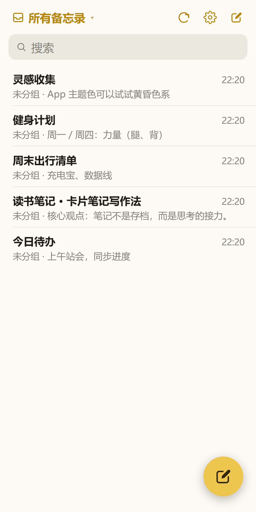
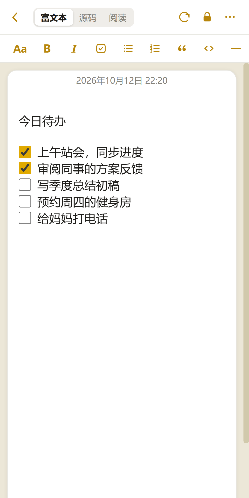
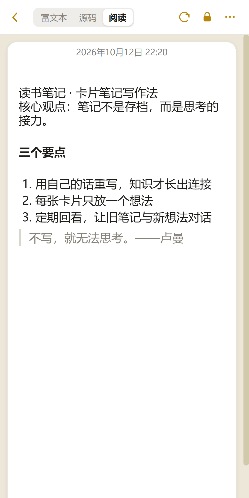
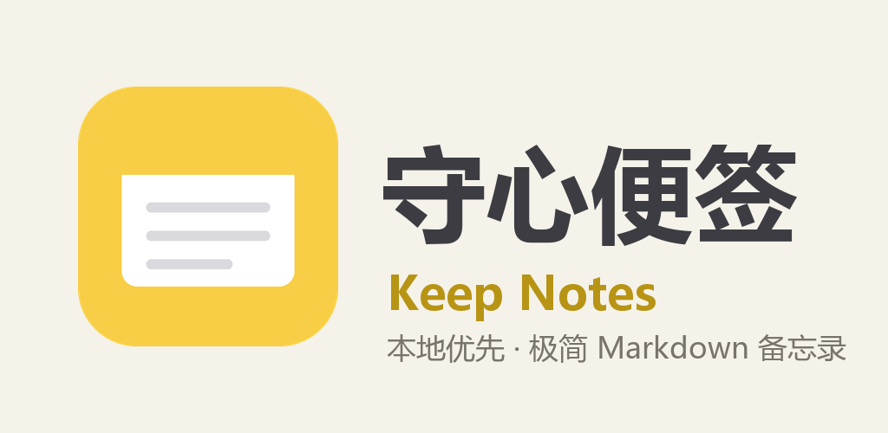

# KeepNots（守心便签）

**隐私优先的极简 Markdown 便签。** 你的笔记是标准的 `.md` 文件，保存在你自己的设备和你自己的网盘里——没有账户，没有统计，没有广告。

*Privacy-first minimalist Markdown notes. Your notes are plain `.md` files on your own devices and your own cloud drive — no accounts, no analytics, no ads.*

<p align="center">
  
  
  
  
</p>

**License / 许可证：[AGPL-3.0](LICENSE)** · Android 4.4+ / Windows / 浏览器 · 界面语言：中文 / English

---

## 为什么是 KeepNots

市面上不缺好用的便签，缺的是**数据完全属于你**的便签：

- **标准 Markdown 存储**：每条便签是一个带 frontmatter 的 `.md` 文件，用任何编辑器都能打开，十年后依然如此
- **本地优先**：便签实时写入你选择的本地文件夹（可整体拷走备份），应用数据库只作缓存双写
- **同步到自己的网盘**：坚果云 / 任意 WebDAV / Google Drive，自动节流上传、失败退避重试、冲突保留副本
- **端侧加密**：按条加密（AES-256-GCM + PBKDF2 15 万次迭代），密码不离开设备，忘记密码无法恢复——连开发者也读不到
- **诚实的服务端**：在线中继只负责转发请求，不存储任何笔记内容；你也可以完全不使用它

## 功能一览

- **苹果备忘录式界面**：桌面两栏、手机单栏 + 左滑操作；浅色 / 深色跟随系统
- **编辑 / 阅读双视图**：所见即所得编辑（自动与 Markdown 互转，中文输入法不跳光标）、渲染阅读（清单可直接勾选）
- **核对清单**：`- [ ]` 任务清单，回车自动延续
- **图片附件**：粘贴 / 拖拽插入，副本随网盘同步；加密便签的图片一并加密
- **排版**：对齐 / 行距 / 段距，随文件跨设备同步
- **分组与标签**：虚拟分组（删除分组不删便签）、标签搜索
- **最近删除**：保留 30 天，跨设备同步，防误删（他端删除不会被本机"复活"）
- **分享为长图**（Android）：把便签渲染成图片直接分享 / 存入图库
- **离线解锁器**：每条加密便签附带一个双击即开的 HTML 页面，没有本应用也能输密码查看
- **中英双语界面**：设置 → 外观 → 语言

## 下载

| 渠道 | 说明 |
|---|---|
| [GitHub Releases](../../releases) | 安卓 APK（自用签名，覆盖安装保留数据）+ Windows 桌面版安装包 |
| 自行打包 | 见下文「构建」 |

> **安卓双产物**：`ZNotes-x.y.z.apk` 兼容安卓 4.4+（老机型如锤子 T1 友好，ES5 + polyfill 管线）；`ZNotes-x.y.z.aab` 为 Google Play 基线（minSdk 24 / targetSdk 36，SAF 存储）。

## 快速开始

**网页版**：把 `notes-app/` 部署到任意静态托管（GitHub Pages / Vercel / nginx），手机浏览器打开后「添加到主屏幕」即可像 App 一样使用；桌面直接双击 `index.html` 也可用。

**首次使用**：打开应用 → 首启向导里选择一个本地文件夹（便签将实时保存为 .md）→ 设置里配置坚果云 / WebDAV 同步（可选）。数据永远先落在本地。

**桌面版**（Windows，Electron）：`cd notes-app/desktop && npm install && npx electron .`，或用 `node dev/build-desktop.mjs` 打安装包。

**自托管在线服务**（可选，纯转发中继 + 账户公测）：见 [`server/deploy-render.md`](notes-app/server/deploy-render.md)，Render 免费层约 10 分钟部署。

## 构建

```bash
cd notes-app
npm install                # Babel 转译与测试依赖

node dev/node-test.mjs     # 57 项逻辑回归
node dev/check-layout.mjs  # 61 项布局 E2E（需本机 Edge）

node dev/build-apk.mjs     # 安卓 APK（兼容安卓 4.4+）→ android/dist/
node dev/build-aab.mjs     # Google Play AAB（需 .apk-tools 工具链，见下）
node dev/build-desktop.mjs # Windows 桌面版安装包 → desktop/dist/
```

安卓打包需要 Android 构建工具链（`notes-app/.apk-tools/`，约 240MB，可按 `dev/build-apk.mjs` 头部说明自行下载解压；不打包可跳过）。

## 项目结构

```
notes-app/
├── index.html / core.js / app.js / style.css   # 网页版（唯一源头）
├── core.js          # 数据层：IndexedDB、加密、同步引擎
├── app.js           # 界面层
├── android/         # 安卓壳（WebView + FsBridge，免 gradle 打包）
├── desktop/         # Electron 桌面版
├── cloudflare/      # Cloudflare Worker 部署（静态 + WebDAV 转发中继）
├── server/          # 可选在线服务（Render）：公测账户 + WebDAV 中继，不存笔记内容
├── store/           # 商店素材（截图 / 图标 / 特性图）
└── dev/             # 打包脚本与 226 项自动化测试
```

## 隐私

| 数据 | 存在哪 |
|---|---|
| 便签内容 | 你的设备 + 你配置的网盘（可选） |
| 加密密码 | 只在你的设备内存中，永不外发 |
| 网盘凭据 | 只存在你的设备上，仅用于连接你选择的网盘 |
| 在线中继 | 只转发请求（限流防滥用），不落盘任何内容 |

完整声明：[隐私政策](https://keepnotes.cc.cd/privacy)。应用无统计 SDK、无广告、无账户体系。

## 命名

**KeepNots**——故意少一个 e：Keep Notes 太容易撞名，而去掉一个字母之后，全网搜索只有我们。也像 knots（结绳记事）：把要紧的事，打个结。中文叫**守心便签**：守住你的心事了。

## License

Copyright © 2026 the KeepNots authors.

This program is free software: you can redistribute it and/or modify it under the terms of the **GNU Affero General Public License** as published by the Free Software Foundation, version 3 only. See [LICENSE](LICENSE).

---

### English

**KeepNots** is a privacy-first minimalist Markdown notes app (Apple Notes-inspired). Notes are plain `.md` files with YAML frontmatter, saved in real time to a local folder you pick, with optional sync to your own WebDAV drive (Jianguoyun preset) or Google Drive. Per-note encryption uses AES-256-GCM with PBKDF2 (150k iterations); the password never leaves your device. No accounts, no analytics, no ads.

Platforms: **Web** (static hosting / PWA), **Windows** (Electron), **Android** (4.4+ via an ES5+polyfill pipeline; modern baseline AAB for Google Play). UI language: Chinese / English.

Build: `cd notes-app && npm install`, then `node dev/build-apk.mjs` (Android APK), `node dev/build-aab.mjs` (Play AAB), `node dev/build-desktop.mjs` (Windows installer). Tests: `node dev/node-test.mjs` + `node dev/check-layout.mjs`.

Licensed under the **GNU AGPL-3.0**.
